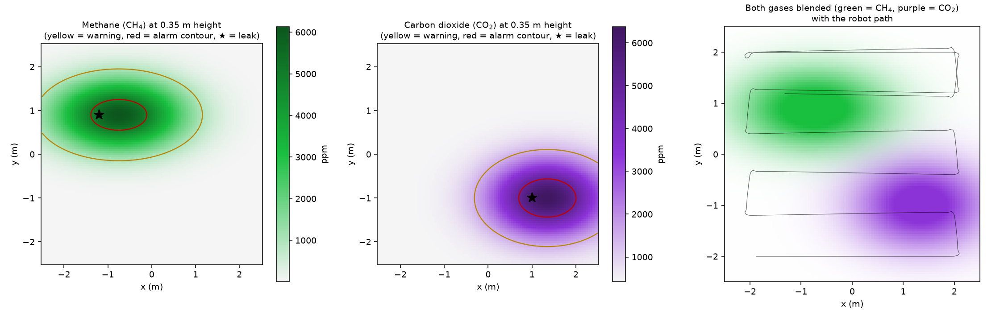

# Robotics Lab — CSE (AI & ML), 2026 Batch

Simulation experiments for the Robotics course, built on **CoppeliaSim 4.10** or **Webots R2025a**
and controlled from **Python**. Each experiment is a complete lab record: aim, theory, requirements, hypotheses,
step-by-step procedure, the code that runs it, **real results produced by that code**, discussion,
conclusion, viva questions and practice exercises.

## Start here

1. **Install the software:** [docs/INSTALLATION.md](docs/INSTALLATION.md) (about 30 minutes).
2. **Read the workflow** below, so you know what a complete experiment record contains.
3. **Do the experiment.**

| # | Experiment | Concepts | Time |
|---|---|---|---|
| 06 | [Webots robotics simulations: e-puck swarm and Pioneer lidar navigation](experiments/exp06-webots-robotics-sim/) (uses **Webots R2025a**, see its [GUIDE](experiments/exp06-webots-robotics-sim/GUIDE.md)) | Braitenberg swarm obstacle avoidance, supervisor logging, arena coverage, lidar follow-the-gap navigation, parameter sweeps | — |
| 07 | [Mobile gas-mapping robot with real-time telemetry to a base station](experiments/exp07-gas-mapping-robot/) | gas plumes (CH₄ vs CO₂), sensor dynamics, coverage path, go-to-goal control, TCP telemetry, live Excel logging, map reconstruction, alarm reliability | 2 h |



## Quick start (after installation)

Open three terminals in `experiments/exp07-gas-mapping-robot` and run `source ~/sim-venv/bin/activate` in each.

```bash
coppeliasim                  # terminal 1: the simulator (close any licence dialog)
python base_station.py       # terminal 2: the base station, logs to results/gas_log.xlsx
python gas_explorer.py       # terminal 3: the robot explores for 120 s
python analyse.py            # afterwards: figures + summary.json
```

## Systematic workflow for every experiment

Your lab record must contain all 14 steps:

1. **Title and aim:** what the experiment is for, in one sentence.
2. **Learning objectives:** what you will be able to do afterwards.
3. **Theory:** the equations and ideas the experiment tests.
4. **Requirements:** software, hardware, prior knowledge.
5. **Hypotheses:** what you *predict*, written **before** running anything.
6. **Experimental design:** independent, dependent and controlled variables.
7. **Setup and architecture:** how the scene, robot and programs fit together.
8. **Procedure:** numbered steps that anyone can repeat exactly.
9. **Observations:** what you saw, filled into the observation table.
10. **Data recording:** what files were saved and what each column means.
11. **Analysis:** how raw data became figures and numbers.
12. **Results:** figures and numbers, without interpretation.
13. **Discussion and conclusion:** were the hypotheses right, why, and what limits the result.
14. **Viva questions and practice exercises.**

## Repository layout

```
robotics-csAIML-2026/
├── README.md                       this page
├── LICENSE                         MIT
├── docs/INSTALLATION.md            installation guide + troubleshooting
└── experiments/
    ├── exp06-webots-robotics-sim/  Webots R2025a: e-puck swarm + Pioneer lidar (own README + GUIDE)
    └── exp07-gas-mapping-robot/
        ├── README.md               full lab manual (start here for the experiment)
        ├── gas_field.py            gas plume + gas sensor models
        ├── base_station.py         TCP server -> live Excel log
        ├── gas_explorer.py         robot: scene, path, sensing, telemetry
        ├── analyse.py              figures and summary from the Excel log
        └── results/                our run: gas_log.xlsx, CSVs, 6 figures, summary.json
```

## Ground rules

- Write your hypotheses **before** you run anything.
- Never edit numbers by hand. Every figure must come from `analyse.py` run on your own data.
- If your numbers differ from ours, report them and explain why. A different CoppeliaSim version,
  PC speed or changed parameter will change them.

## Licence

Code and text: MIT Licence ([LICENSE](LICENSE)). CoppeliaSim is © Coppelia Robotics AG and is
used here under its free educational (Edu) licence, which covers students and teachers.
