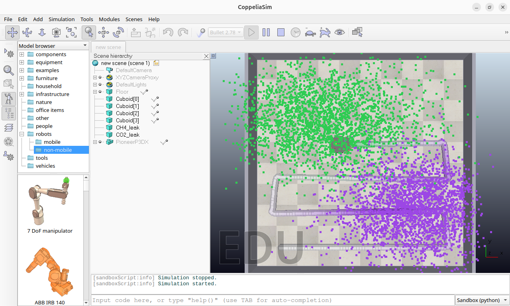
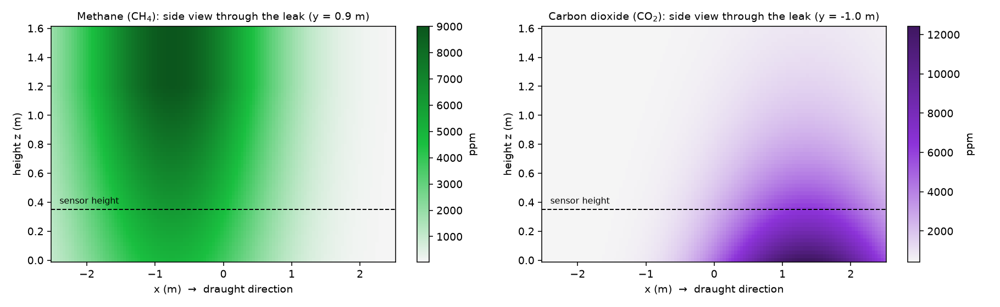
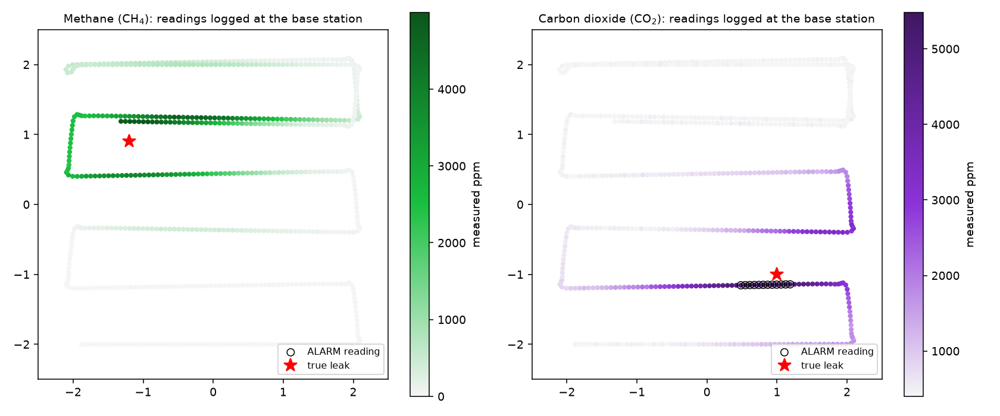
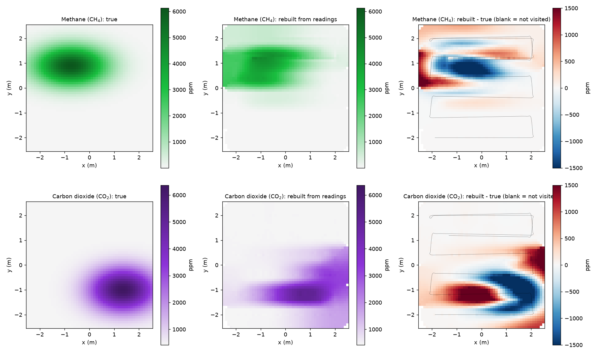
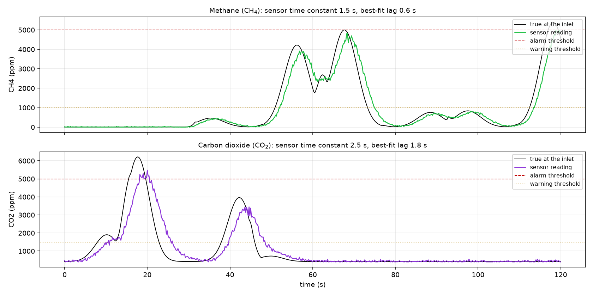
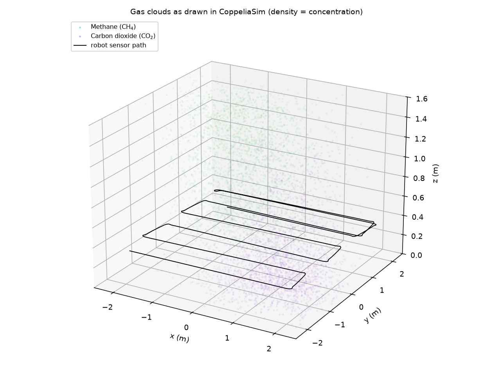

# Experiment 07 — Mobile Gas-Mapping Robot with Real-Time Telemetry to a Base Station

**Course:** Robotics Lab, CSE (AI & ML), 2026 batch
**Software:** CoppeliaSim 4.10 Edu, Python 3 (ZMQ Remote API, openpyxl, matplotlib)
**Duration:** about 2 hours (30 min setup, 2 min run, 60 min analysis and write-up)


*CoppeliaSim during a run (top view, t ≈ 55 s): the robot is crossing the green methane cloud; the purple CO₂ cloud is at the lower right; the trail of small balls behind the robot shows what it measured (grey = clean air, purple = CO₂).*

---

## 1. Aim

To build a mobile robot that carries a methane (CH₄) and carbon-dioxide (CO₂) sensor, explores a
room with two gas leaks for 120 seconds, and streams every reading with its location to a base
station in real time, where it is logged to an Excel sheet. Then use the logged data to locate
the leaks, and measure how sensor response time affects the map and the alarms.

## 2. Learning objectives

After this experiment you will be able to:

1. Explain how a gas spreads from a leak and why a light gas (CH₄) and a heavy gas (CO₂) behave differently.
2. Model a real gas sensor: response lag (time constant), noise, resolution and measuring range.
3. Drive a differential-drive robot along a coverage (lawnmower) path with a go-to-goal controller.
4. Send sensor data from a robot to a base station over a TCP network link, and log it to Excel live.
5. Rebuild a concentration map from scattered readings (inverse-distance weighting).
6. Judge a sensing system quantitatively: map error, hotspot error, missed and late alarms.

## 3. Theory

### 3.1 The gases

| Gas | Density (kg/m³) | Compared with air (1.20) | Where it collects | Background level | Alarm level used |
|---|---|---|---|---|---|
| Methane, CH₄ | 0.66 | lighter | rises towards the ceiling | ≈ 2 ppm | **5 000 ppm** = 10 % of its lower explosive limit (LEL = 5 % vol = 50 000 ppm) |
| Carbon dioxide, CO₂ | 1.98 | heavier | pools near the floor | ≈ 420 ppm | **5 000 ppm** = common 8-hour occupational exposure limit |

*ppm* = parts per million by volume. 10 000 ppm = 1 %.
Warning levels are set lower (CH₄ 1 000 ppm, CO₂ 1 500 ppm) to give early notice.

### 3.2 Gas field model

Each leak forms a plume. A gentle draught towards +x stretches and shifts the plume downwind.
The concentration of gas *g* at a point (x, y, z) is

$$C_g(x,y,z) = C_{g,\text{bg}} + P_g \exp\!\left[-\frac{1}{2}\left(\frac{(x-x_s-d)^2}{\sigma_\parallel^2} + \frac{(y-y_s)^2}{\sigma_\perp^2}\right)\right] h_g(z)$$

- $(x_s, y_s)$ is the leak position, *d* the downwind shift, $\sigma_\parallel$ and $\sigma_\perp$ the spread along and across the draught, and $P_g$ the peak strength.
- The height profile $h_g(z)$ encodes buoyancy:
  - CH₄: $h(z) = 0.55 + 0.45\,\min(z/1.2,\,1)$, which **grows** with height.
  - CO₂: $h(z) = e^{-z/0.5}$, which **falls** with height.

| | Leak (x, y) m | Peak above background | σ across / along (m) | Downwind shift (m) |
|---|---|---|---|---|
| CH₄ | (−1.2, 0.9) | 9 000 ppm | 0.55 / 1.0 | 0.45 |
| CO₂ | (1.0, −1.0) | 12 000 ppm | 0.60 / 0.9 | 0.35 |



> This is a steady-state *Gaussian plume* model, a standard first approximation in
> environmental engineering. It is computed in Python (`gas_field.py`). CoppeliaSim has no gas
> physics, so it is used for the robot, the room and the visualisation.

### 3.3 Sensor model (first-order system)

A real gas sensor does not respond instantly. Gas has to diffuse into the sensing chamber, so
the reading *R* follows the true concentration *C* like a first-order low-pass filter:

$$\tau \frac{dR}{dt} = C - R \quad\Rightarrow\quad R_{k+1} = R_k + (C_k - R_k)\left(1-e^{-\Delta t/\tau}\right)$$

After a sudden change the reading reaches 63 % of the new value after τ seconds and 90 % after
≈ 2.3 τ. On top of the lag the model adds noise, rounds to the resolution, and clips to the range:

| Sensor | Time constant τ | Noise (1σ) | Resolution | Range |
|---|---|---|---|---|
| CH₄ | 1.5 s | 15 ppm + 2 % of reading | 1 ppm | 0 – 10 000 ppm |
| CO₂ (NDIR type) | 2.5 s | 30 ppm + 3 % of reading | 1 ppm | 400 – 10 000 ppm |

A moving robot makes this lag matter. At 0.32 m/s the robot travels 0.8 m during one CO₂ time constant.

### 3.4 Robot motion

The Pioneer P3-DX is a differential-drive robot. A go-to-goal controller steers to each waypoint
of a lawnmower path (6 lanes, 0.8 m apart, covering |x|, |y| ≤ 2 m):

$$\alpha = \text{wrap}\big(\operatorname{atan2}(y_g-y,\,x_g-x)-\theta\big),\qquad v = v_\max\cos^3\alpha,\qquad \omega = 2.5\,\alpha$$

$$\omega_L = \frac{v-\omega L/2}{r},\qquad \omega_R=\frac{v+\omega L/2}{r}\qquad (r = 0.0975\text{ m},\ L = 0.331\text{ m})$$

The $\cos^3\alpha$ term makes the robot turn almost on the spot when it faces the wrong way.

### 3.5 Telemetry and mapping

Every 0.2 s (5 Hz) the robot sends one JSON message over TCP:
`{"n": 57, "t": 11.2, "x": 1.673, "y": -2.0, "z": 0.35, "CH4": 2.0, "CO2": 1596.0, "CH4_status": "NORMAL", "CO2_status": "WARNING", ...}`.
The base station appends it to the Excel sheet and saves the file every second.

The map is rebuilt with **inverse-distance weighting (IDW)**. The value at a grid cell is the
weighted mean of the readings within 0.6 m, with weights $w_i = 1/d_i^2$.

## 4. Requirements

**Software:** follow [../../docs/INSTALLATION.md](../../docs/INSTALLATION.md) first.

| Item | Version used |
|---|---|
| Ubuntu (VirtualBox guest) | 26.04 LTS |
| CoppeliaSim Edu | 4.10.0 rev 0 |
| Python | 3.14 (any 3.10+ works) |
| Python packages | `coppeliasim-zmqremoteapi-client`, `pyzmq`, `cbor2`, `numpy`, `matplotlib`, `openpyxl` |
| Spreadsheet viewer | LibreOffice Calc or Microsoft Excel (to open the log) |

**Hardware:** any PC with 8 GB RAM. A second PC on the same network is optional, to act as a
separate base station.

**Prior knowledge:** basic Python, coordinate frames, the idea of a feedback controller.

## 5. Files

| File | Role |
|---|---|
| `gas_field.py` | Gas plume model, sensor model, alarm thresholds, colours |
| `base_station.py` | TCP server; logs readings to `results/gas_log.xlsx` (+ CSV) in real time |
| `gas_explorer.py` | Builds the scene, drives the robot, reads the sensors, streams the data |
| `analyse.py` | Reads the Excel log and makes the figures and `summary.json` |
| `run_experiment.sh` | Runs the whole experiment with one command (section 9.1) |
| `results/` | Data and figures from our run (yours will overwrite them) |

## 6. System architecture

```
 ┌──────────────────────── CoppeliaSim 4.10 ────────────────────────┐
 │  room 5 m x 5 m, walls                                           │
 │  CH4 cloud (green) ─┐   drawn as translucent points:             │
 │  CO2 cloud (purple) ┘   density and opacity = concentration      │
 │  Pioneer P3-DX + sensor mast (inlet at 0.35 m)                   │
 └─────────────▲──────────────────────────────────┬─────────────────┘
               │ ZMQ Remote API (port 23000)       │ pose of sensor head
 ┌─────────────┴──────────────────────────────────▼─────────────────┐
 │ gas_explorer.py  (the "robot computer")                          │
 │  lawnmower planner → go-to-goal → wheel speeds                   │
 │  gas_field.concentration() at inlet → GasSensor (lag+noise)      │
 └─────────────┬────────────────────────────────────────────────────┘
               │ TCP port 5055, one JSON line per reading (5 Hz)
 ┌─────────────▼────────────────────────────────────────────────────┐
 │ base_station.py  (the "base station")                            │
 │  → results/gas_log.xlsx  (Readings / Summary / Charts sheets)    │
 │  → results/gas_log.csv                                           │
 └──────────────────────────────────────────────────────────────────┘
```

## 7. Hypotheses (write yours down before running)

- **H1:** The robot will find both leaks. The highest readings will come from within 0.5 m of each true hotspot.
- **H2:** Because of sensor lag, each reading will appear **behind** the robot's true position along
  its direction of travel, and peak readings will be **lower** than the true peaks.
- **H3:** The slower CO₂ sensor (τ = 2.5 s) will show more lag and a larger map error than the CH₄ sensor (τ = 1.5 s).
- **H4:** Readings near the floor-level CO₂ leak will be high. CH₄ readings at 0.35 m will be lower
  than they would be higher up, because methane rises.

## 8. Experimental design

| | |
|---|---|
| **Independent variables** | gas type (CH₄ vs CO₂); sensor time constant (exercise 3); sensor height (exercise 2) |
| **Dependent variables** | readings (ppm), map error, hotspot location error, alarm count, alarm delay, measured lag |
| **Controlled variables** | room and leak layout, robot speed 0.32 m/s, sample rate 5 Hz, run time 120 s, lawnmower path, random seeds |
| **Reference** | true concentration at the inlet, saved by the robot in `robot_truth.csv` (the base station never sees it) |

## 9. Procedure — step by step (Ubuntu, using the Terminal)

Everything below is typed into the **Terminal on the Ubuntu machine itself**. There is no second
computer and no SSH: CoppeliaSim, the robot program and the base station all run on the same
Ubuntu PC. (The robot program still talks to CoppeliaSim through its built-in local link on port
23000; that is how Python controls the simulator, and it stays inside the same machine.)

Open the Terminal with **Ctrl + Alt + T**. Open extra tabs with **Ctrl + Shift + T**.

### 9.0 First time only: get the code

```bash
cd ~
git clone https://github.com/qai-science/robotics-csAIML-2026.git
cd ~/robotics-csAIML-2026/experiments/exp07-gas-mapping-robot
chmod +x run_experiment.sh
```

(If you have not installed CoppeliaSim and the Python environment yet, do
[docs/INSTALLATION.md](../../docs/INSTALLATION.md) first.)

### 9.1 Option A: one command does everything

```bash
cd ~/robotics-csAIML-2026/experiments/exp07-gas-mapping-robot
./run_experiment.sh
```

The script prints five stages:

```
[1/5] CoppeliaSim            starts it (or uses the one already open)
[2/5] checking the Python link to CoppeliaSim      OK
[3/5] base station (log: results/gas_log.xlsx)
[4/5] robot exploring (watch the CoppeliaSim window)
[5/5] analysis
Done. Results in .../results
```

Watch the CoppeliaSim window during stage 4. Then open the results:

```bash
xdg-open results/gas_log.xlsx
xdg-open results/fig1_true_gas_field.png
```

Any robot option can be added, for example `./run_experiment.sh --duration 60`.

### 9.2 Option B: run each part yourself, in three Terminal tabs

Doing it by hand shows how the parts fit together. Use this for the lab record.

**Tab 1: start CoppeliaSim.**

```bash
cd ~/CoppeliaSim
LIBGL_ALWAYS_SOFTWARE=1 ./coppeliaSim.sh
```

`LIBGL_ALWAYS_SOFTWARE=1` makes CoppeliaSim draw on the CPU. Inside VirtualBox this is needed,
because the virtual 3-D driver crashes it (`vmw_ioctl_command error ... Aborted`). On a PC with a
real graphics card you can start it with just `./coppeliaSim.sh`. Wait for the window. **If a
licence or registration dialog appears, close it.** While it is open, CoppeliaSim does not answer Python.

**Tab 2: check the link, then start the base station.**

```bash
cd ~/robotics-csAIML-2026/experiments/exp07-gas-mapping-robot
source ~/sim-venv/bin/activate
python -c "from coppeliasim_zmqremoteapi_client import RemoteAPIClient as R; print(R().require('sim').getSimulationState())"
```

It must print `0`. If it hangs, close the dialog in CoppeliaSim and try again. Then:

```bash
python base_station.py
```

Expected: `[base] listening on 0.0.0.0:5055, logging to .../results/gas_log.xlsx`. Leave it running.

**Tab 3: start the robot.**

```bash
cd ~/robotics-csAIML-2026/experiments/exp07-gas-mapping-robot
source ~/sim-venv/bin/activate
python gas_explorer.py
```

What you should see:

1. `[robot] building the scene ...`. CoppeliaSim switches to a **top view** of the 5 m × 5 m room:
   a green dot cloud (CH₄) round the leak at the upper left, a purple dot cloud (CO₂) round the leak
   at the lower right, two coloured leak discs, and the robot with its yellow sensor head at the
   bottom-left corner.
2. Tab 2 prints `[base] robot connected from 127.0.0.1:...`.
3. The robot sweeps the room back and forth for **120 s of simulated time**. Behind the sensor it lays
   small coloured balls that show what it measured: grey = clean air, green = methane, purple = CO₂.
4. Every 5 s both tabs print a reading. WARNING and ALARM readings appear in Tab 2.

Building the scene takes about 10 s (the 5 000 cloud points are added one by one). After that every
simulation step is drawn, so the motion is smooth. On our VirtualBox VM (8 cores, software rendering)
the full run kept real time: 120.0 s simulated in 120.1 s, with all 2 401 steps drawn. On a slower PC
the run may take a little longer than 120 s; the time column in the Excel file is always simulation
time. To keep strictly to the wall clock instead (the view then updates less often), use
`python gas_explorer.py --view realtime`.

**Tab 4 (optional): watch the Excel file grow during the run.**

```bash
cd ~/robotics-csAIML-2026/experiments/exp07-gas-mapping-robot
libreoffice --calc results/gas_log.xlsx
```

Close and reopen it to see new rows; the base station saves it every second. Status cells are
green (NORMAL), yellow (WARNING) or red (ALARM). Do not save the file from LibreOffice during the run.

**Finish.** The robot prints `[robot] done: 601 readings in 120.0 s simulated ...`. Tab 2 prints
`run finished: 601 readings saved` and stops; it has added the **Summary** and **Charts** sheets.

**Analyse** (Tab 2 or 3):

```bash
python analyse.py
xdg-open results/fig5_measured_vs_true.png
```

This writes six figures and `results/summary.json`.

**Run again.** CoppeliaSim can stay open. Repeat Tab 2 (`python base_station.py`) and Tab 3
(`python gas_explorer.py`). To keep the old results, log the new run to its own file:
`python base_station.py --out results/run2.xlsx`.

**Stop everything.** Press **Ctrl + C** in any tab still running, and close CoppeliaSim.

### 9.3 After the run

1. **Record observations** in the table in section 10.
2. **Compare with the hypotheses** and write the discussion and conclusion (sections 13–14).
3. **Do the practice exercises** in section 16.

### Running the base station on a different computer (optional)

Run `python base_station.py` on the other PC, and find its IP address (`ip addr` on Linux,
`ipconfig` on Windows). Then start the robot with

```bash
python gas_explorer.py --base-host 192.168.1.10
```

Use that PC's IP, and allow TCP port 5055 in its firewall.

### Useful options

| Command | Effect |
|---|---|
| `python gas_explorer.py --duration 60` | shorter run |
| `python gas_explorer.py --ideal-sensors` | no lag or noise, for comparison |
| `python gas_explorer.py --fast` | as fast as possible, not tied to real time |
| `python gas_explorer.py --view realtime` | keep exactly to the wall clock; the view updates only when there is time |
| `python gas_explorer.py --cloud-style spheres` | translucent 3-D gas spheres (nicer, but slow to draw on a VM) |
| `python gas_explorer.py --sample-period 0.5` | 2 readings per second |
| `python base_station.py --out results/run2.xlsx` | log a second run to a separate file |

## 10. Observation table (fill in from your run)

| Quantity | CH₄ | CO₂ |
|---|---|---|
| Number of readings logged | | |
| Maximum reading (ppm) and where (x, y) | | |
| Number of WARNING / ALARM readings | | |
| Time the true value first crossed the alarm level (s) | | |
| Time the sensor first reported ALARM (s) | | |
| Hotspot error of the rebuilt map (m) | | |
| RMSE reading vs true (ppm) | | |

## 11. Data recorded

**Excel sheet `Readings`** (one row per reading, 5 per second):

| Reading # | Wall clock | Sim time (s) | X (m) | Y (m) | Sensor height (m) | CH4 (ppm) | CH4 status | CO2 (ppm) | CO2 status | Link delay (ms) |
|---|---|---|---|---|---|---|---|---|---|---|
| 57 | 2026-10-15 02:06:22.680 | 11.2 | 1.673 | −2.0 | 0.35 | 2 | NORMAL | 1596 | WARNING | 0.1 |

The **Summary** sheet holds the peaks, means, peak locations and alarm counts. The **Charts**
sheet plots both gases against reading number.
`results/robot_truth.csv` holds, for the same instants, the true concentrations, used only in the analysis.

## 12. Results (our run, 15 Oct 2026)

**Run statistics:** 601 readings in 120.0 simulated seconds, finished in 120.2 s of wall-clock
time (real time). All 601 arrived at the base station and are in the Excel file. Mean network
delay 0.37 ms (max 4.4 ms; both programs on one VM). Path length 37.0 m. The map covers 99 % of the room.

| Quantity | CH₄ | CO₂ |
|---|---|---|
| Maximum reading | 4 998 ppm at (−1.19, 1.19) | 5 481 ppm at (0.61, −1.15) |
| Highest **true** value on the path | 5 398 ppm | 6 215 ppm |
| True hotspot at 0.35 m height | (−0.80, 0.90) | (1.30, −1.00) |
| Hotspot of the map rebuilt from readings | (−1.00, 1.20) | (0.60, −1.20) |
| **Hotspot error** | **0.36 m** | **0.73 m** |
| RMSE reading vs true | 428 ppm | 608 ppm |
| Mean absolute error | 247 ppm | 324 ppm |
| WARNING readings / ALARM readings | 149 / **0** | 108 / 12 |
| Samples where the true value was at alarm level | 14 | 21 |
| True value first at alarm level | t = 67.6 s | t = 15.6 s |
| Sensor first reported ALARM | **never** | t = 18.2 s (**2.6 s late**) |
| Lag that best aligns reading with truth | 0.6 s | 1.8 s |


*Figure 4: what the base station received. Colour is the measured ppm; black rings are ALARM readings; the star is the true leak.*


*Figure 5: true map (left), map rebuilt from the readings (middle), difference (right). Red = over-read, blue = under-read.*


*Figure 6: true concentration at the inlet (black) and the sensor reading (colour) over time.*


*Figure 3: the two clouds as drawn in CoppeliaSim. CH₄ (green) spreads upward; CO₂ (purple) hugs the floor.*

## 13. Discussion

1. **Both leaks were found (H1 partly supported).** The rebuilt CH₄ hotspot was 0.36 m from the
   true one, but the CO₂ hotspot was 0.73 m off, outside the 0.5 m we predicted.
2. **Lag shifts and flattens the map (H2 supported).** In Figure 6 the coloured curves trail the
   black ones and their peaks are lower. In Figure 5 the error maps show the classic lag pattern: a
   blue (under-read) band where the robot entered the plume and a red (over-read) band where it left,
   displaced along each lane in the direction of travel.
3. **The slower sensor is worse (H3 supported).** CO₂ (τ = 2.5 s) shows three times the best-fit lag
   of CH₄ (1.8 s vs 0.6 s), twice the hotspot error, and a larger RMSE. The best-fit lag is shorter than
   τ because a first-order filter delays a smooth, hump-shaped signal by less than τ.
4. **A missed alarm.** The most important result for safety: methane really did exceed the alarm
   level 14 times along the path, but the lagging sensor peaked at 4 998 ppm, **2 ppm below the
   threshold, and never alarmed**. For CO₂ the alarm came 2.6 s late, while the robot had already
   moved about 0.8 m. A moving gas detector must either slow down in suspicious areas, use a faster
   sensor, or set its alarm threshold lower to allow for the lag.
5. **Height matters (H4).** At 0.35 m the CO₂ plume keeps 50 % of its floor value, but the
   methane plume only 68 % of its value at 1.2 m height. A sensor's mounting height must suit the
   gas it hunts.
6. **Sources of error and limitations:**
   - The gas field is a steady model; real plumes fluctuate (turbulence) and change over time.
   - The robot's own motion does not disturb the gas.
   - Readings exist only along the path, so the map between lanes (0.8 m apart) and between the outer lanes and the walls is interpolated; the strong red patches at the room edges in Figure 5 are interpolation artefacts, not sensor errors.
   - The CO₂ sensor's 400 ppm lower range limit clips readings in clean air (420 ppm ± noise).
   - Network delay is tiny here because both programs ran on one machine; over Wi-Fi expect 5–50 ms.

## 14. Conclusion

A Pioneer P3-DX carrying CH₄ and CO₂ sensors covered a 5 m × 5 m room in 120 s and streamed 601
geo-tagged readings in real time to a base station, which logged every one to Excel. The readings
located both leaks, to within 0.36 m (CH₄) and 0.73 m (CO₂). Sensor response time was the dominant
error. It displaced the map, lowered the peaks, and caused one missed alarm (CH₄) and one late alarm
(CO₂, 2.6 s), so for a moving gas detector, response time matters as much as accuracy.

## 15. Viva questions

1. Why does methane collect near the ceiling and CO₂ near the floor?
2. What is the lower explosive limit (LEL) of methane, and why are alarms set at 10 % LEL?
3. A sensor has τ = 2 s. How long after a sudden step does it reach 90 % of the new value?
4. Why does a first-order lag make the map appear shifted in the direction of travel?
5. Why do we send readings as JSON over TCP instead of writing the Excel file on the robot itself?
6. What would happen to the map if the lanes were 1.6 m apart instead of 0.8 m?
7. Give two ways to avoid the missed methane alarm without buying a new sensor.
8. What does inverse-distance weighting assume about the gas field between two readings?
9. Why is the true value saved by the robot but not sent to the base station?
10. Which of the controlled variables would you expect to have the biggest effect on the map error, and why?

## 16. Practice exercises for the class

Each exercise changes one thing. Run it, analyse it with `python analyse.py`, and compare with our
results table. Save each run to its own file with `python base_station.py --out results/exN.xlsx`.
`analyse.py` reads `results/gas_log.xlsx`, so copy your file there first, or keep each run in its own folder.

1. **Ideal sensors.** Run `python gas_explorer.py --ideal-sensors`. How do the hotspot error and the
   alarm count change? This isolates the error caused by the sensors from the error caused by the path.
2. **Mounting height.** In `gas_explorer.py` change `SENSOR_Z = 0.35` to `1.0`. Which gas gets
   easier to detect and which harder? Relate this to Figure 2.
3. **Faster or slower sensor.** In `gas_field.py` change the CO₂ `tau` to `0.5` and then `5.0`.
   Plot hotspot error against τ. Is the relation roughly linear?
4. **Slow down to detect.** Run with `--speed 0.15`. The robot covers less area in 120 s; does the
   map get better or worse? Find the best speed for a 120 s mission.
5. **Adaptive speed.** Edit the control loop so the robot halves its speed whenever either reading
   is above the WARNING level. Does the missed methane alarm disappear?
6. **Lag compensation.** A first-order sensor can be inverted: $\hat C = R + \tau\,dR/dt$. Add this
   estimate to the base station (estimate $dR/dt$ from successive readings) and log it as an extra
   column. Is it closer to the truth? What happens to the noise?
7. **Lane spacing.** Change `LANE = 0.8` to `0.5` and `1.2`. How do coverage and hotspot error change?
8. **A third gas.** Add hydrogen sulphide (H₂S, density 1.36 kg/m³, alarm 10 ppm) to `SOURCES`,
   `ALARM`, `WARN` and `COLOR` with its own colour, and add its sensor. Which part of the room does it collect in?
9. **Remote base station.** Run the base station on a classmate's laptop on the same Wi-Fi
   (section 9). Report the mean and maximum *Link delay (ms)* from the Excel sheet.
10. **Find the leak automatically.** Replace the lawnmower path with gradient climbing: after the
    first pass, drive towards the highest reading so far. How close to the true leak can the robot
    get in 120 s?

## 17. Precautions and troubleshooting

- Always start **CoppeliaSim first, then the base station, then the robot**.
- If the robot prints `waiting for base station`, start `base_station.py`, or check the IP and port.
- If nothing happens after `building the scene`, look for a dialog box in CoppeliaSim and close it.
- If CoppeliaSim disappears during a run and the terminal shows `vmw_ioctl_command error ... Aborted`,
  the VirtualBox 3-D driver crashed. Start CoppeliaSim with `LIBGL_ALWAYS_SOFTWARE=1 ./coppeliaSim.sh` (section 9.2).
- If the animation gets slower the longer CoppeliaSim has been open, close it and start it again.
  (`gas_explorer.py` clears old clouds and trails at the start of every run, so this should not happen.)
- If CoppeliaSim is open but the robot never prints `building the scene`, its Python link did not
  start, which happens when it is restarted too quickly after closing. Close it, wait 5 s, and start it again.
- If `Address already in use` appears, an old base station is still running: `pkill -f base_station.py`.
- Do not open and **save** `gas_log.xlsx` in Excel while the base station is writing it. Viewing is fine.
- With `--view realtime` on a slow PC the view refreshes only a few times per second. This is intentional:
  drawing is skipped to keep physics and logging on the wall clock. The data are unaffected.

## 18. References

1. *CoppeliaSim user manual*, Coppelia Robotics. <https://manual.coppeliarobotics.com>
2. Siegwart, R., Nourbakhsh, I. R., Scaramuzza, D. (2011). *Introduction to Autonomous Mobile Robots*, 2nd ed., MIT Press.
3. Lilienthal, A. J., Duckett, T. (2004). Building gas concentration gridmaps with a mobile robot. *Robotics and Autonomous Systems*, 48(1), 3–16.
4. Kowadlo, G., Russell, R. A. (2008). Robot odor localization: a taxonomy and survey. *The International Journal of Robotics Research*, 27(8), 869–894.
5. Seinfeld, J. H., Pandis, S. N. (2016). *Atmospheric Chemistry and Physics*, 3rd ed., Wiley. (Gaussian plume model.)
